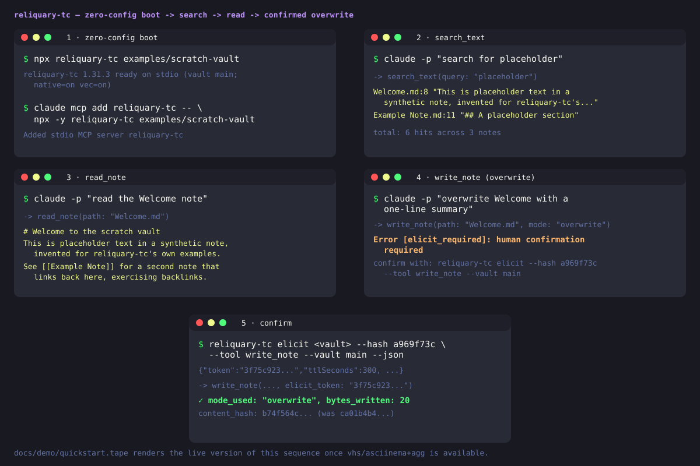

<Columns cols={2}>
  <Card title="Getting started" icon="arrow-right" href="/getting-started/install">
    Install reliquary-tc and connect your first MCP client.
  </Card>
  <Card title="GitHub" icon="github" href="https://github.com/the-40-thieves/reliquary-tc">
    Source, issues and releases.
  </Card>
</Columns>

A static storyboard for now — `docs/demo/quickstart.tape` renders the animated version
(`docs/public/demo/quickstart.gif`) once `vhs` is on your PATH.

## What is reliquary-tc? {#what-is-reliquary-tc}

reliquary-tc is a Model Context Protocol server that exposes an Obsidian vault to AI agents through a broad set of typed tools, presented via a configurable tool-surface facade (a compact triad of meta-tools by default, or the full surface in flat mode). It runs locally or remotely, and supports multi-vault setups and signed-JWT auth. An optional companion plugin, TC Bridge, extends it with live-Obsidian features (command-palette dispatch, Templater, Dataview, and more) over the Obsidian Local REST API — the server runs without it, degrading bridge-only tools gracefully.

Memory you write with reliquary-tc is plain Markdown in your own vault, not a vendor-hosted
feature — see [Memory you own](/getting-started/memory-you-own/) for the on-disk shape, the ACL/
audit pipeline every write goes through, and a session-bootstrap recipe.

v2.0.1 is the current release, published to npm with a container image on GHCR.

See [Getting Started](/getting-started/install/) for install instructions, or browse the [Tool Reference](/tools/).

reliquary-tc sends no telemetry by default; usage telemetry is opt-in, anonymous, and never carries vault content — see [Telemetry](/configuration/telemetry/).
